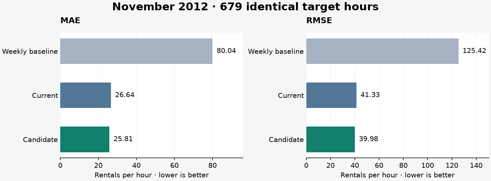
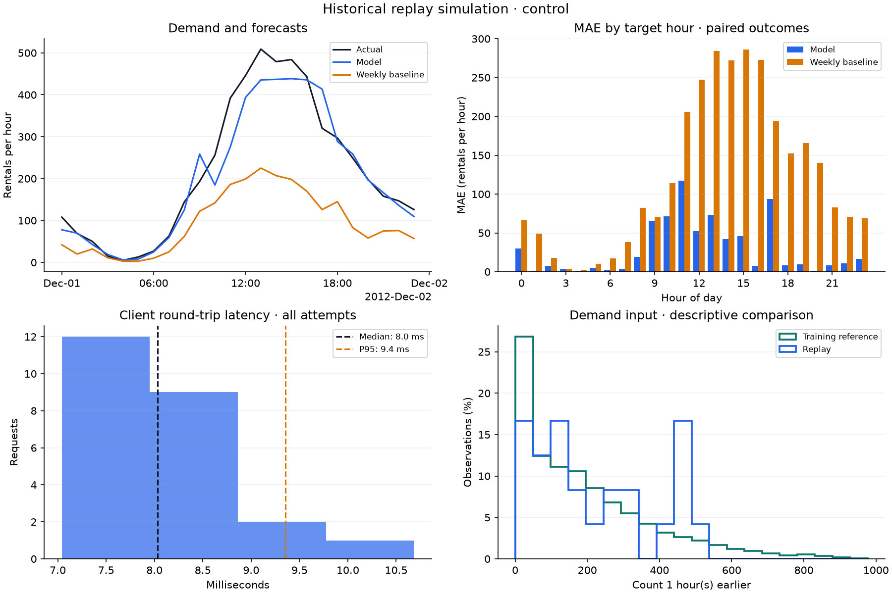

# Bike demand forecasting

[](https://github.com/lecoqm/bike_demand_forecasting/actions/workflows/tests.yml)

A local MLOps project for forecasting the next hour's bike rentals. It takes a
model from chronological evaluation through experiment tracking, HTTP serving,
monitoring, an added-data update, controlled promotion, and rollback.

The final demonstration refits a candidate with October observations, compares
it with the current model on identical November hours, serves it for a December
replay, and verifies that rollback restores the original model after restart.

## Results

The candidate uses the same fixed gradient-boosting configuration as the
current model. Both are scored on **679 identical eligible November 2012
hours**, out of 720 scheduled hours:

| Model | MAE | RMSE |
| --- | ---: | ---: |
| Same hour one week earlier | 80.04 | 125.42 |
| Current model, fitted through September | 26.64 | 41.33 |
| Candidate, fitted through October | **25.81** | **39.98** |

Errors are in rentals per hour. Adding **707 eligible October training
targets** reduces MAE by **3.10%**. The acceptance rule is recorded before
fitting: candidate MAE must be strictly lower, and RMSE must be no higher.
Promotion rechecks the decision, paired predictions, model checksums, and
the identity of the current model.



The subsequent December 1 rehearsal produces **24 predictions for 24 scheduled
hours**, with zero rejected or failed requests. Candidate MAE is **29.00** and
RMSE **43.71** on those 24 outcomes. Rollback then restores the original model,
verified through `/health`, a forecast response, and request logs.



These are retrospective results on an already explored dataset. The November
comparison demonstrates a model update; the one-day December replay checks
the serving lifecycle. Neither establishes performance on future live demand.

## Run the complete demonstration

Use **Python 3.12**. The repository includes the UCI hourly CSV and the original
model artifact. Commands below run from the repository root.

### Windows / PowerShell

```powershell
git clone https://github.com/lecoqm/bike_demand_forecasting.git
cd bike_demand_forecasting
python -m venv .venv
.\.venv\Scripts\Activate.ps1
python -m pip install -r requirements.txt
$env:MLFLOW_DISABLE_TELEMETRY = "true"
python -m pip check
python -m ruff check bike_demand tests
python -m pytest
python -m bike_demand.demo
Start-Process "artifacts/demos/december_day_01/summary.html"
```

### Linux

```bash
git clone https://github.com/lecoqm/bike_demand_forecasting.git
cd bike_demand_forecasting
python3.12 -m venv .venv
source .venv/bin/activate
python -m pip install -r requirements.txt
export MLFLOW_DISABLE_TELEMETRY=true
python -m pip check
python -m ruff check bike_demand tests
python -m pytest
python -m bike_demand.demo
```

Open `artifacts/demos/december_day_01/summary.html` in a browser. The command
creates its own MLflow database, deployment state, logs, and localhost API
processes. It stops those processes before exiting and ends its isolated
deployment on the original model. No server needs to be started beforehand.

Commit source changes before recording an experiment so its Git provenance
identifies a committed revision. Existing demo directories are refused; use
`--output-dir artifacts/demos/another_run` for another rehearsal.

The environment setting disables MLflow's optional usage tracking while
retaining local experiment logging. See the
[MLflow documentation](https://mlflow.org/docs/latest/community/usage-tracking/).

## Forecasting contract and chronology

The input is a target hour and the previous **168 clock-hour counts**, oldest
first. Calendar features, demand lags, and rolling summaries use information
available strictly before the target. The weekly baseline uses the count
exactly 168 hours earlier.

Missing clock hours remain missing rather than becoming zero. Counts one hour
and one week before the target must be known; missing internal history values
are retained. During replay, an outcome is revealed after its forecast and may
become history for a later one-hour forecast. Model weights stay fixed.

| Phase | Target period |
| --- | --- |
| Initial fitting | Before July 1, 2012 |
| Original validation | July through September 2012 |
| Current model refit | All eligible targets before October 1 |
| Candidate update | Add October; refit on all eligible targets before November 1 |
| Shared candidate comparison | November 1 to December 1, end exclusive |
| Final HTTP demonstration | December 1 to December 2, end exclusive |

The estimator is scikit-learn's `HistGradientBoostingRegressor`, using Poisson
loss, 250 iterations, learning rate 0.06, and fixed model settings. Features use
calendar labels and observed demand; same-hour demand and future observations
never enter a target's inputs. The project does not use weather measurements
as if they were available forecasts.

## Components

| Component | Responsibility |
| --- | --- |
| `data.py`, `features.py` | Verify UCI bytes, restore the hourly grid, build causal inputs |
| `train.py`, `track.py` | Chronological evaluation, saved models, local MLflow provenance |
| `api.py`, `request_logging.py` | Validated forecasts, readiness, request IDs and model versions |
| `replay.py`, `monitor.py`, `scenarios.py` | HTTP simulation, coverage/error reporting, reproducible faults |
| `compare.py`, `deploy.py` | Added-data comparison, acceptance checks, selected-model state, rollback |
| `demo.py` | Complete rehearsal through real API subprocesses |

The FastAPI service exposes `GET /health`, `POST /predict`, and interactive
documentation at `/docs`. Responses and JSON request logs identify the exact
loaded artifact with its SHA-256 version. Explicit model overrides take
precedence over managed selection. A selected-model change takes effect when
the API restarts.

## Run individual stages

```powershell
# Reproduce plain training in a new output directory
python -m bike_demand.train --output-dir artifacts/reproduced_current

# Record training with local MLflow
python -m bike_demand.track

# Train and compare a candidate; creates a new comparison directory
python -m bike_demand.compare

# Select an accepted candidate and inspect next-startup selection
python -m bike_demand.deploy promote
python -m bike_demand.deploy status

# Restore the previous model; restart the API to load it
python -m bike_demand.deploy rollback
```

For separate API operation and model overrides, follow the deployment guide.
Use a model directory matching the served version when running replay.

| Guide | Details |
| --- | --- |
| [Replay](docs/replay.md) | Historical requests, outcomes, and failure records |
| [Monitoring](docs/monitoring.md) | Metrics, denominators, plots and missing data |
| [Failure scenarios](docs/scenarios.md) | Missing history, invalid requests, synthetic demand shift |
| [Candidate comparison](docs/model_comparison.md) | Added observations and fixed acceptance rule |
| [Deployment](docs/deployment.md) | Promotion, rollback, restart and override precedence |
| [Final demonstration](docs/final_demo.md) | Complete rehearsal, outputs and MLflow UI |
| [Reproducibility](docs/reproducibility.md) | Fresh-clone checks, CI and reproducibility limits |

## Verification and limits

GitHub Actions installs dependencies, checks their consistency, runs Ruff, and
executes pytest on **Ubuntu and Windows with Python 3.12**. Tests cover causal
features, missing-hour alignment, API validation, saved prediction agreement,
request tracing, monitoring denominators, fault injection, candidate fitting
boundaries, stale/invalid promotion, rollback, and the real HTTP rehearsal.

Prediction coverage uses all scheduled hours. Model scores use the same
eligible outcomes as their baseline; a low error score cannot conceal missing
predictions. Input-distribution comparisons are descriptive and do not prove
concept drift or automatically trigger retraining.

This is a local historical simulation. It assumes earlier observed counts
arrive in time for the next one-hour forecast. Timestamps retain the dataset's
timezone-naive clock labels. The project does not model delayed outcomes,
timezone/DST conversion, remote deployment, authentication, or high availability.
Latency shown in example reports is specific to the machine and run.

Top-level dependencies are pinned. Transitive packages and native libraries
can vary, and serialized bytes can differ across platforms. Tests compare
predictions numerically; artifact hashes identify individual saved files.

## Data attribution

Hourly counts come from the **UCI Bike Sharing dataset**, covering the Capital
Bikeshare system in 2011–2012. This project uses the hourly total count `cnt`.

Fanaee-T, H. (2013). *Bike Sharing* [Dataset]. UCI Machine Learning Repository.
[DOI: 10.24432/C5W894](https://doi.org/10.24432/C5W894).
The dataset is distributed under
[CC BY 4.0](https://creativecommons.org/licenses/by/4.0/).
